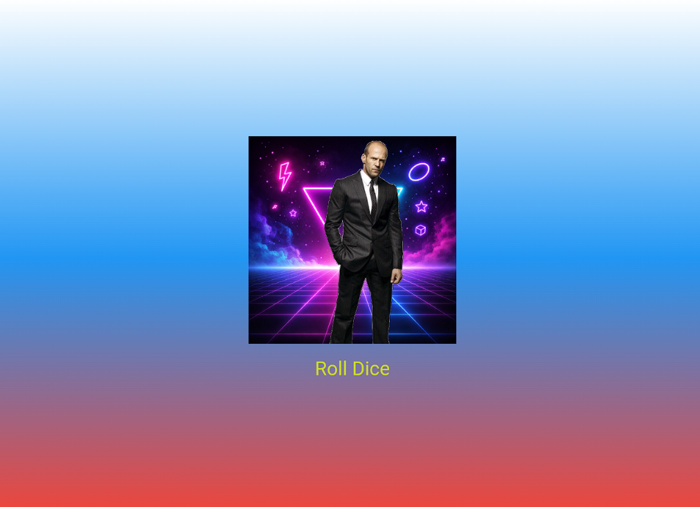

# Лабораторная работа №4-5. Flutter: структура UI и компонентный подход

Приложение Roll Dice App, созданное на Flutter. При нажатии на кнопку показывает случайную игральную кость на фоне градиента.

## Информация об авторе

Студент: Афанасьев Глеб Викторович
Группа: ИСП-242

## Что изучили

1. Научились выносить виджеты в отдельные файлы и классы.
2. Разобрались, как передавать данные через параметры конструктора (final поля).
3. Изучили разницу между StatelessWidget и StatefulWidget.
4. Поняли, как работает setState() для обновления интерфейса.
5. Научились подключать локальные картинки (assets) через pubspec.yaml.

## Скриншот приложения

## Ссылка на репозиторий

[GitHub репозиторий](https://github.com/Fraay/Flutter_Widgets)

## Инструкция по запуску

1. Клонировать репозиторий: `git clone <https://github.com/Fraay/Flutter_Widgets>`
2. Перейти в папку: `cd flutter_widgets_afanasev`
3. Установить зависимости: `flutter pub get`
4. Запустить: `flutter run -d chrome`

## Ответы на вопросы

## Ответы на вопросы

1. Зачем выносить виджеты в отдельные файлы? Что изменится если держать всё в `main.dart`?

Вынесение виджетов в отдельные файлы делает код модульным, чистым и читаемым. Если держать всё в `main.dart`, файл быстро разрастётся до сотен или тысяч строк, в нём станет тяжело ориентироваться. Кроме того, отдельные файлы гораздо удобнее редактировать (меньше конфликтов при командной работе) и переиспользовать в других проектах.

2. Что такое `BuildContext`? Почему метод `build()` принимает его как параметр?

`BuildContext` — это ссылка на местоположение виджета в дереве виджетов (Widget Tree). Он нужен виджету, чтобы знать, где именно он находится, и иметь доступ к родительским данным (например, к `Theme`, размерам экрана или MediaQuery). Метод `build()` принимает его, потому что фреймворк Flutter вызывает `build()` каждый раз, когда виджету нужно перерисоваться, и передаёт актуальный контекст, чтобы виджет мог правильно построить свой интерфейс.

3. Чем `StatelessWidget` отличается от `StatefulWidget`? Приведите пример когда нужен каждый из них.

`StatelessWidget` — это неизменяемый виджет. Он рисуется один раз и больше не меняется (если не изменились его входные параметры). Пример: `Text`, `Icon` или шапка приложения (`AppBar`). `StatefulWidget` — изменяемый виджет, который хранит своё состояние (`State`) и может перерисовываться при вызове метода `setState()`. Пример: кнопка, которая меняет цвет при нажатии, или наш кубик, который меняет картинку при клике.

4. Почему `Random()` создаётся на уровне файла, а не внутри `rollDice()`?

Если создавать `Random()` внутри метода `rollDice()` (например, `Random().nextInt(6)`), то при каждом нажатии на кнопку создавался бы новый экземпляр генератора случайных чисел. В Dart `Random()` при инициализации использует текущее время. Если создавать его слишком часто (в один и тот же момент времени), он может выдавать одинаковые числа. Создание на уровне файла гарантирует, что генератор инициализируется один раз, и последовательность случайных чисел будет качественной.
